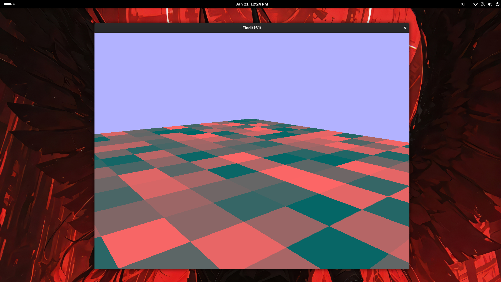

# findit
<div align="center">
  
</div>

**The station engine in C++** is a pilot project for studying station angles, rendering and optimization of visibility.

## What is it
Simple station sandbox with troughs 16x16x16. Generates random cubes, performs visibility checking (culling of hidden edges), renders via OpenGL. So far tech demo is the basis for a future game.

## Technologies used
- **C++17** - Engine Base
- **OpenGL 3.3+** - Cube rendering (VAO/VBO)
-**GLM** - vector mathematics, transformation
- **GLEW** - OpenGL functions loading
- **SDL** - window and input
-**Icon** - help from above

## Implementation Features
**Chanc 163 == 4096 stations**
**Generation of positions + color**                   
**Culling by neighbors (ivec3 hash)**  
**Custom matrices model**

## Management
-**WASD** - movement
- **Mouse** - overview
- **Esc** - exit

## Build (Linux)
```bash
# Clone repo
git clone https://github.com/mental0-main/findit.git && cd findit

# Build
mkdir build && cd build
cmake .
make -j$(nproc)

# Run
./findit
```

## Other
- **Status:** Project on pause. Base ready.
- **Plans:** The world of plates, textures, lighting.

## License
This project licensed under the **MIT License**.
